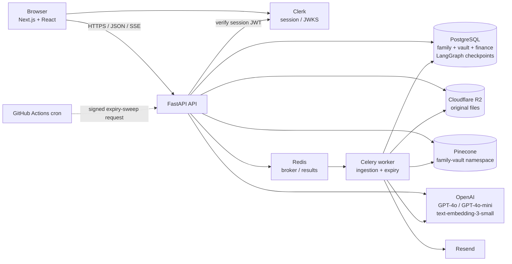
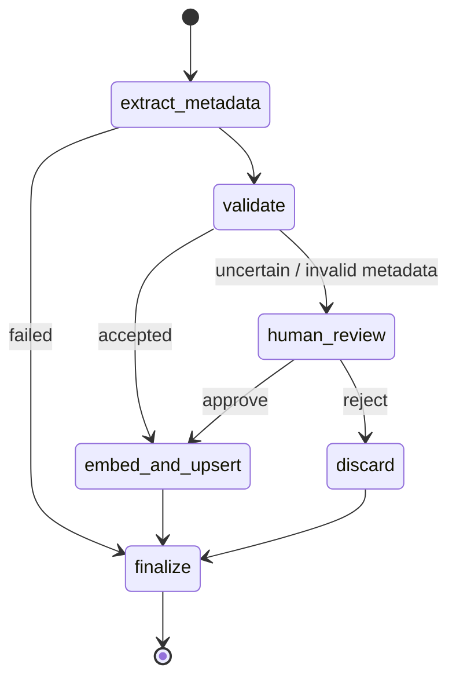

# FamGuard AI — Technical Design

| Field | Value |
|---|---|
| Status | Current implementation reference |
| Functional design | [requirements.md](requirements.md) |
| Technology inventory | [technology-stack.md](technology-stack.md) |
| RAG and agent integration | [rag-agent-one-pager.md](rag-agent-one-pager.md) |

This design follows the code in `backend-api`, `worker`, `frontend`, and `infrastructure`. Deployment values are configuration-dependent; the checked-in Render Blueprint describes the current combined API/worker service, while the local Compose stack is intended for development.

## 1. System architecture

### Components

| Component | Responsibility |
|---|---|
| `frontend` | Next.js app for vault chat, document uploads/history, review queue, users/categories, financial data, finance dashboard, and service health. Clerk provides sign-in; API calls use the authenticated session. |
| `backend-api` | FastAPI routes, request validation, Clerk JWT verification, role/tenant enforcement, Postgres repositories, storage/vector adapters, ingestion and RAG graph construction. |
| `worker` | Celery tasks for document ingestion/review resume and expiry notification; Celery Beat schedules the daily sweep in worker mode. |
| `infrastructure` | Docker image and entrypoint, local Compose services, deployment manifests, migrations and Pinecone bootstrap/cron utilities. |

## 2. Data and persistence

PostgreSQL is the source of truth for family/member relationships, categories, documents, pending reviews, expiry-alert idempotency, and financial metadata. The `documents` row tracks processing status, original-file key, extracted business fields, chunk count, and index version. Composite family/member constraints and family-scoped repository queries preserve tenant boundaries. LangGraph checkpoints use PostgreSQL in deployed environments and an in-memory saver in tests.

Original files are stored through an S3-compatible object-storage adapter (Cloudflare R2 in configured deployments). Local/fake mode can use a shared local volume. The API returns short-lived signed download URLs rather than file bytes for normal document access.

Pinecone stores searchable chunks in the configured namespace (default `family-vault`). Record IDs use `{document_id}#{chunk_index}`; metadata carries family, member, document, category, source, and relevant extracted fields. Optional fields are omitted when absent. The bootstrap script validates/creates a serverless index with 1536 dimensions and cosine similarity. The adapter also supports Pinecone integrated-embedding schemas; explicit embeddings are used when the configured index does not provide integrated embedding.

## 3. Document ingestion agent

1. The upload route validates size, file signature, filename, and supported type; stores the original and creates a processing row.
2. The API queues a Celery task. The worker starts or resumes a LangGraph thread keyed by the upload thread ID.
3. The graph prepares images/PDF pages or extracts DOCX/XLSX text, then calls the structured-output GPT-4o metadata extractor with the family category list.
4. Validation routes low-confidence (< `0.75`), missing/unparseable alert dates, and unknown categories to a review interrupt. The Postgres checkpointer preserves the paused graph. Rejection discards the original; approval can include corrected metadata.
5. Accepted text is chunked (800 tokens, 100-token overlap using `cl100k_base`), embedded, and upserted. Index version and document status are written to Postgres. Task retries use bounded backoff.

## 4. Conversational RAG agent

`POST /api/vault/chat` returns `text/event-stream`. The LangGraph RAG workflow resolves an optional member/category filter, embeds the question where necessary, retrieves up to eight candidates, verifies candidate document status and index version against Postgres, then streams a grounded answer. The event protocol is `filter`, repeated `token`, `sources`, optional `error`, and `done`.

The family filter is always derived from the authenticated principal. Member users are forcibly limited to their own member ID. Admin member-name resolution is matched against the caller's family roster; arbitrary user-supplied IDs are not accepted as retrieval scope. Source events identify documents, and an empty eligible result produces a fixed not-found response. The answer generator is not given tools. See the [RAG/agent one-pager](rag-agent-one-pager.md) for setup and operational flow.

## 5. Financial data

Financial imports are handled as structured income/expense rows or `.xlsx` workbooks; rows are validated and indexed for semantic search. Financial views read completed family-scoped records from Postgres. The dashboard computes currency-separated monthly summaries, future estimates from history, unpaid upcoming bills, expected cashflows, and undated rows. Projections are explicitly marked as projected. Editing an entry reindexes a new vector version before updating its current database record.

## 6. APIs and runtime

Routes are grouped under `/api/me`, `/api/members`, `/api/vault`, and `/api/vault/financial`; operations expose `/healthz`, `/readyz`, and a timestamped HMAC-signed expiry-sweep trigger. The OpenAPI schema in `backend-api/openapi.json` is the authoritative detailed contract.

`infrastructure/docker-compose.yml` runs PostgreSQL, Redis, Mailpit, API, and worker; by default it enables fake external integrations for local development. The root `render.yaml` currently defines a single Render web service in `RUN_MODE=combined`; GitHub Actions triggers the daily expiry sweep because the free combined deployment does not run Celery Beat. A separate worker mode with Beat is supported by the same container for deployments that run a dedicated worker.

## 7. Security and reliability boundaries

- Clerk session JWTs are verified against configured issuer/JWKS and allowed origins. Admin-only operations use an explicit admin principal.
- Tenant identity is derived server-side and applied to database queries and Pinecone filters. Retrieved matches are checked again against current searchable Postgres rows and index versions to reject stale/deleted vectors.
- Upload parsers validate signatures and enforce format, size, and conversion limits. Image normalization removes EXIF metadata; R2 keys are scoped to family/document identifiers.
- RAG prompts treat retrieved content as data, and answer generation does not expose tools.
- Redis-backed rate limits protect chat, upload, and bulk-import surfaces. Celery uses JSON task payloads, late acknowledgements, and retries.
- `/readyz` reports dependency readiness for Postgres, Redis, and Pinecone; `/healthz` is the lightweight liveness endpoint.

## 8. Validation

Python backend and worker tests use pytest with fakes/mocks for external services; integration checks cover API behavior, graph interruption/resume, tenant isolation, vector filters, storage, and ingestion. The frontend uses Vitest/Testing Library and Playwright. Project manifests and CI workflows define the current lint, type-check, build, and test commands.
