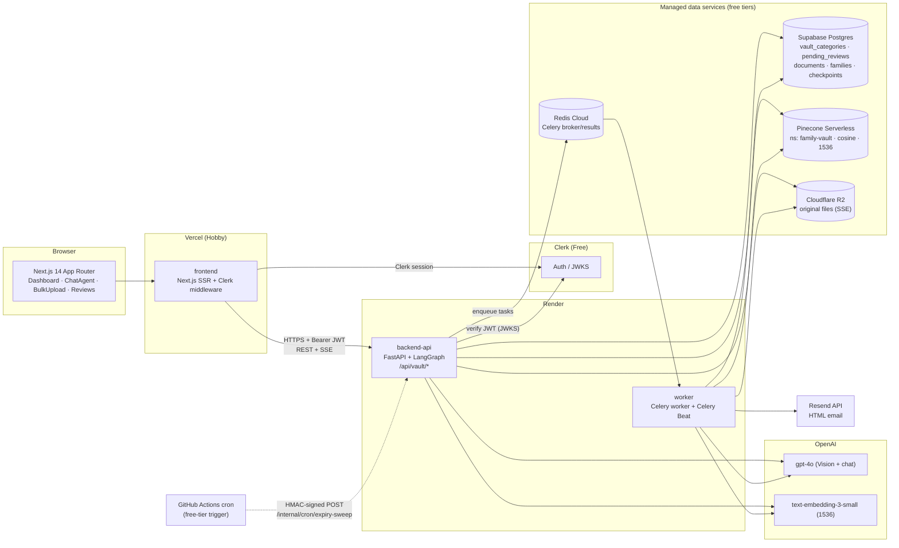
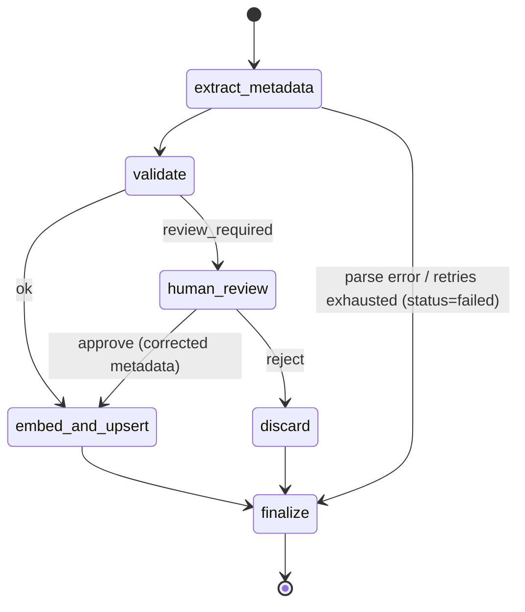
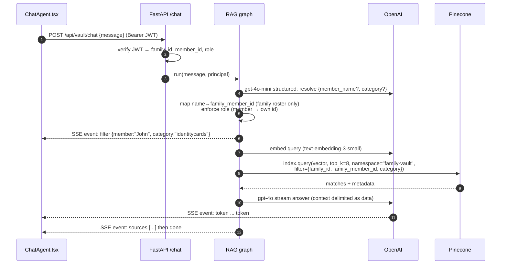
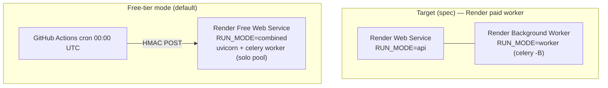

# FamGuard AI — Technical Design

| Field | Value |
|---|---|
| Version | 1.0 (High-level design) |
| Requirements | [requirements.md](requirements.md) |
| Tracker | [master-tracker.md](master-tracker.md) |

---

## 1. Architecture Overview



### 1.1 Component responsibilities

| Component | Project | Responsibility |
|---|---|---|
| Next.js frontend | `frontend` | UI, Clerk sign-in, calls API with Bearer token, consumes SSE |
| FastAPI API | `backend-api` | Auth, validation, REST/SSE endpoints, LangGraph graphs, Postgres/Pinecone/R2 access |
| LangGraph ingestion graph | `backend-api` (`app/agents/graph.py`) | Extract → validate → (interrupt for HITL) → embed → upsert |
| LangGraph RAG graph | `backend-api` (`app/agents/rag_engine.py`) | Resolve filter → embed query → filtered Pinecone query → answer stream |
| Celery worker + Beat | `worker` | Runs ingestion jobs, daily expiry sweep, Resend emails |
| Infra | `infrastructure` | Dockerfiles, `.dockerignore`, `render.yaml`, Pinecone/Supabase bootstrap scripts, CI/CD, cron trigger |

## 2. Repository Layout (monorepo)

```
FamGuard/
├── .dockerignore                    # build context = repo root
├── .github/workflows/               # CI + free-tier cron trigger (owned by infrastructure)
├── docs/
│   ├── requirements.md
│   ├── design.md
│   └── master-tracker.md
├── backend-api/
│   ├── IMPLEMENTATION_PLAN.md
│   ├── pyproject.toml               # package "famguard-api", import name "app"
│   ├── app/
│   │   ├── __init__.py
│   │   ├── config.py                # pydantic-settings
│   │   ├── database.py              # asyncpg pool, DDL, repositories
│   │   ├── security.py              # Clerk JWT verification, RBAC deps
│   │   ├── storage.py               # R2 (boto3 S3 client), signed URLs
│   │   ├── vectorstore.py           # Pinecone client, upsert/query helpers
│   │   ├── parsers.py               # magic-byte sniffing, PDF/HEIC/DOCX/XLSX → images/text
│   │   ├── agents/
│   │   │   ├── state.py             # UnifiedVaultExtraction, HITLState, IngestionState, RAGState
│   │   │   ├── prompts.py
│   │   │   ├── graph.py             # ingestion graph + checkpointer factory
│   │   │   └── rag_engine.py        # RAG graph + streaming
│   │   └── api/
│   │       ├── main.py              # FastAPI app, routers, CORS, health
│   │       ├── schemas.py           # request/response models
│   │       └── routes/              # vault.py, categories.py, reviews.py, chat.py, internal.py
│   └── tests/
├── worker/
│   ├── IMPLEMENTATION_PLAN.md
│   ├── pyproject.toml               # depends on famguard-api (path dependency)
│   ├── famguard_worker/
│   │   ├── worker.py                # Celery app + Beat schedule (spec "app/worker.py")
│   │   ├── tasks/ingestion.py
│   │   ├── tasks/expiry_sweep.py
│   │   └── email/templates.py       # inline-styled HTML builders
│   └── tests/
├── frontend/
│   ├── IMPLEMENTATION_PLAN.md
│   ├── package.json
│   ├── src/
│   │   ├── middleware.ts            # Clerk
│   │   ├── lib/api.ts               # typed fetch + SSE client
│   │   ├── lib/types.ts
│   │   └── app/
│   │       ├── layout.tsx
│   │       ├── page.tsx             # dashboard
│   │       ├── reviews/page.tsx
│   │       └── components/
│   │           ├── ChatAgent.tsx
│   │           ├── BulkUpload.tsx
│   │           ├── CategoryForm.tsx
│   │           ├── MetricCard.tsx
│   │           └── ReviewCard.tsx
│   └── tests/ (vitest) · e2e/ (playwright)
└── infrastructure/
    ├── IMPLEMENTATION_PLAN.md
    ├── docker/
    │   ├── Dockerfile               # spec "Dockerfile": 2-stage, /opt/venv, appuser, HEALTHCHECK; one image for all RUN_MODEs
    │   ├── entrypoint.sh            # RUN_MODE=api | worker (celery + beat) | combined (uvicorn + celery)
    │   ├── healthcheck.py           # /healthz and/or celery ping depending on RUN_MODE
    │   └── collect_requirements.py  # dependency layer caching
    ├── docker-compose.yml           # local dev: postgres, redis, mailpit, api, worker (+ combined profile)
    └── scripts/
        ├── bootstrap_pinecone.py
        ├── migrate.py
        └── trigger_expiry_sweep.py  # signed cron call used by the GitHub cron workflow

(repo root) render.yaml                  # Render Blueprint (must live at the repo root)
(repo root) .github/workflows/ci.yml     # path-filtered CI + gated deploy job
(repo root) .github/workflows/cron-expiry-sweep.yml
```

## 3. Data Model

### 3.1 Postgres (Supabase)

`database.py` owns the DDL and applies it idempotently on startup (`CREATE ... IF NOT EXISTS`) through `migrate.py`.

```sql
CREATE EXTENSION IF NOT EXISTS pgcrypto;

CREATE TABLE IF NOT EXISTS families (
    id              UUID PRIMARY KEY DEFAULT gen_random_uuid(),
    name            TEXT NOT NULL,
    timezone        TEXT NOT NULL DEFAULT 'UTC',
    currency        CHAR(3) NOT NULL DEFAULT 'USD',
    created_at      TIMESTAMPTZ NOT NULL DEFAULT now()
);

CREATE TABLE IF NOT EXISTS family_members (
    id              UUID PRIMARY KEY DEFAULT gen_random_uuid(),
    family_id       UUID NOT NULL REFERENCES families(id) ON DELETE CASCADE,
    clerk_user_id   TEXT UNIQUE,                       -- NULL for dependents
    display_name    TEXT NOT NULL,
    email           TEXT,
    role            TEXT NOT NULL CHECK (role IN ('admin','member','dependent')),
    created_at      TIMESTAMPTZ NOT NULL DEFAULT now(),
    UNIQUE (family_id, display_name)
);

CREATE TABLE IF NOT EXISTS vault_categories (
    id                     UUID PRIMARY KEY DEFAULT gen_random_uuid(),
    family_id              UUID REFERENCES families(id) ON DELETE CASCADE, -- NULL = baseline
    category_slug          TEXT NOT NULL CHECK (category_slug ~ '^[a-z0-9]+(-[a-z0-9]+)*$'),
    category_display_name  TEXT NOT NULL,
    is_baseline            BOOLEAN NOT NULL DEFAULT FALSE,
    created_at             TIMESTAMPTZ NOT NULL DEFAULT now()
);
CREATE UNIQUE INDEX IF NOT EXISTS ux_vault_categories_family_slug
    ON vault_categories (COALESCE(family_id, '00000000-0000-0000-0000-000000000000'::uuid), category_slug);

CREATE TABLE IF NOT EXISTS documents (
    id                UUID PRIMARY KEY DEFAULT gen_random_uuid(),
    family_id         UUID NOT NULL REFERENCES families(id) ON DELETE CASCADE,
    family_member_id  UUID NOT NULL REFERENCES family_members(id) ON DELETE CASCADE,
    thread_id         TEXT UNIQUE,
    category_slug     TEXT NOT NULL,
    document_name     TEXT NOT NULL,
    original_filename TEXT,
    r2_object_key     TEXT,
    sha256            CHAR(64),
    expiration_date   DATE,
    requires_alert    BOOLEAN NOT NULL DEFAULT FALSE,
    financial_value   NUMERIC(14,2),
    chunk_count       INT NOT NULL DEFAULT 0,
    source            TEXT NOT NULL CHECK (source IN ('upload','bulk','chat')),
    status            TEXT NOT NULL CHECK (status IN ('processing','review_required','completed','failed','rejected')),
    created_at        TIMESTAMPTZ NOT NULL DEFAULT now(),
    UNIQUE (family_id, sha256)
);
CREATE INDEX IF NOT EXISTS ix_documents_expiry ON documents (expiration_date) WHERE requires_alert;

CREATE TABLE IF NOT EXISTS pending_reviews (
    id                  UUID PRIMARY KEY DEFAULT gen_random_uuid(),
    thread_id           TEXT NOT NULL UNIQUE,
    family_id           UUID NOT NULL REFERENCES families(id) ON DELETE CASCADE,
    family_member_id    UUID NOT NULL REFERENCES family_members(id) ON DELETE CASCADE,
    document_id         UUID REFERENCES documents(id) ON DELETE CASCADE,
    original_filename   TEXT NOT NULL,
    raw_text            TEXT NOT NULL,
    suggested_metadata  JSONB NOT NULL,
    confidence_score    REAL NOT NULL CHECK (confidence_score BETWEEN 0 AND 1),
    review_reasons      TEXT[] NOT NULL DEFAULT '{}',
    status              TEXT NOT NULL DEFAULT 'open' CHECK (status IN ('open','approved','rejected')),
    resolved_by         UUID REFERENCES family_members(id),
    resolved_at         TIMESTAMPTZ,
    created_at          TIMESTAMPTZ NOT NULL DEFAULT now()
);

CREATE TABLE IF NOT EXISTS alert_log (
    id             BIGSERIAL PRIMARY KEY,
    document_id    UUID NOT NULL REFERENCES documents(id) ON DELETE CASCADE,
    days_before    SMALLINT NOT NULL CHECK (days_before IN (30,7,1)),
    recipient      TEXT NOT NULL,
    resend_id      TEXT,
    sent_at        TIMESTAMPTZ NOT NULL DEFAULT now(),
    UNIQUE (document_id, days_before, recipient)
);
```

The spec-mandated columns of `vault_categories` (`id, family_id, category_slug, category_display_name`) and `pending_reviews` (`id, thread_id, family_member_id, original_filename, raw_text, suggested_metadata, confidence_score`) are preserved verbatim; additional columns support tenancy, auditing and idempotency.

LangGraph `PostgresSaver` creates its own `checkpoints*` tables via `checkpointer.setup()`.

> **Supabase connection note:** use the **session pooler (port 5432)** for both asyncpg and `PostgresSaver` (psycopg3). The transaction pooler (6543) breaks prepared statements.

### 3.2 Pinecone record

- Index: `famguard-vault`, serverless (AWS `us-east-1`, the Starter-plan region), metric `cosine`, dimension `1536`.
- Namespace: `family-vault` (single namespace; tenancy enforced by metadata filters).
- Vector id: `{document_id}#{chunk_index}`.

| Metadata key | Type | Notes |
|---|---|---|
| `family_id` | string | **Always** in every query filter |
| `family_member_id` | string | |
| `document_id` | string | |
| `category` | string | baseline or custom slug |
| `document_name` | string | |
| `expiration_date` | string `YYYY-MM-DD` | **omitted** when null (Pinecone forbids null metadata) |
| `requires_alert` | bool | |
| `financial_value` | number | omitted when null |
| `chunk_index` | int | |
| `is_primary` | bool | `true` only for chunk 0 — used by the expiry sweep to avoid duplicates |
| `source` | string | `upload` / `bulk` / `chat` |
| `text` | string | chunk text, ≤ 8 KB (metadata limit is 40 KB per record) |

Chunking: ~800 tokens, 100-token overlap (`tiktoken cl100k_base`).

## 4. Agent State Schemas (`app/agents/state.py`)

```python
class UnifiedVaultExtraction(BaseModel):
    category: str
    document_name: str
    expiration_date: date | None          # serialized "YYYY-MM-DD"
    requires_alert: bool
    extracted_text: str                   # OCR text or semantic photo caption
    financial_value: float | None
    confidence_score: float = Field(ge=0, le=1)   # model self-assessment, used for HITL

class HITLState(BaseModel):
    review_required: bool = False
    review_reasons: list[str] = []
    pending_review_id: UUID | None = None
    reviewer_decision: Literal["approve", "reject"] | None = None
    corrected: UnifiedVaultExtraction | None = None

class ThreadMetrics(TypedDict):
    started_at: str
    extraction_ms: int
    embedding_ms: int
    prompt_tokens: int
    completion_tokens: int
    chunks_upserted: int

class IngestionState(TypedDict):
    thread_id: str
    family_id: str
    family_member_id: str
    document_id: str
    original_filename: str
    mime_type: str
    r2_object_key: str
    allowed_categories: list[str]
    extraction: UnifiedVaultExtraction | None
    hitl: HITLState
    metrics: ThreadMetrics
    status: Literal["processing", "review_required", "completed", "failed", "rejected"]
    error: str | None
```

The model is called with `ChatOpenAI(model="gpt-4o").with_structured_output(UnifiedVaultExtraction)`; `expiration_date` is validated with a strict ISO parser — an unparseable value becomes `None` and adds reason `expiration_unparsed`.

## 5. Ingestion Pipeline (`app/agents/graph.py`)



| Node | Behavior |
|---|---|
| `extract_metadata` | **Node 1**: download from R2; sniff type; images → JPEG (HEIC via `pillow-heif`, EXIF stripped); PDF → up to 10 pages at 150 DPI (`pypdfium2`); DOCX/XLSX → text. Then `ChatOpenAI(model="gpt-4o")` Vision with structured output (function calling), prompt includes the family's allowed categories; 3 attempts with backoff. Images are not stored in graph state, so they are never written to checkpoints |
| `validate` | Rules: (a) `requires_alert and expiration_date is None` → `review_required=True`; (b) `confidence < 0.75`; (c) category not in allowed list → set `miscellaneous` + review |
| `human_review` | Inserts `pending_reviews` row, sets document `status=review_required`, then calls LangGraph `interrupt(...)` — graph halts; state persisted by checkpointer |
| `embed_and_upsert` | Chunk → `text-embedding-3-small` → Pinecone upsert (batches of 100) → update `documents` |
| `discard` | Delete R2 object, mark document `rejected` |
| `finalize` | Record metrics, status |

**Resume:** `POST /api/vault/resolve-review` → `graph.invoke(Command(resume={"decision": ..., "corrected": ...}), config={"configurable": {"thread_id": ...}})`.

**Checkpointer factory:** `get_checkpointer()` returns `PostgresSaver` (via `langgraph-checkpoint-postgres`) when `ENV != "test"`, else `MemorySaver`.

## 6. Conversational RAG (`app/agents/rag_engine.py`)



Filter construction (server side only):

```python
flt = {"family_id": {"$eq": principal.family_id}}
if member_id: flt["family_member_id"] = {"$eq": member_id}
if category:  flt["category"] = {"$eq": category}
if principal.role == "member": flt["family_member_id"] = {"$eq": principal.member_id}
```

SSE events: `filter`, `token`, `sources`, `error`, `done` (each `data:` is JSON).

## 7. HITL Sequence

```mermaid
sequenceDiagram
    autonumber
    participant FE as Frontend
    participant API as FastAPI
    participant Q as Redis/Celery
    participant W as Worker
    participant G as Ingestion graph
    participant DB as Postgres
    FE->>API: POST /upload (file, member_id)
    API->>DB: insert documents(status=processing)
    API->>Q: ingest_document.delay(thread_id)
    API-->>FE: 202 {thread_id}
    Q->>W: task
    W->>G: invoke(thread_id)
    G->>DB: insert pending_reviews; interrupt()
    FE->>API: GET /pending-reviews
    FE->>API: POST /resolve-review {thread_id, decision, corrected}
    API->>Q: resume_ingestion.delay(thread_id, payload)
    W->>G: invoke(Command(resume=payload))
    G->>DB: documents.status=completed; pending_reviews.status=approved
```

## 8. Expiry Sweep (`worker/famguard_worker/worker.py` + `tasks/expiry_sweep.py`)

- Beat: `"daily-expiry-sweep": {"task": "famguard.expiry_sweep", "schedule": crontab(hour=0, minute=0)}`; `timezone = settings.CELERY_TIMEZONE` (default `UTC`).
- For `offset in (30, 7, 1)`: `target_date = (today + timedelta(days=offset)).isoformat()`.
- Query: `index.query(vector=DUMMY_VECTOR, top_k=1000, namespace="family-vault", include_metadata=True, filter={"expiration_date": {"$eq": target_date}, "is_primary": {"$eq": True}, "requires_alert": {"$eq": True}})`.
- `DUMMY_VECTOR = [0.0] * 1535 + [1.0]` — cosine rejects all-zero vectors; ranking is irrelevant because only the filter matters.
- If `len(matches) == 1000` → log warning and fall back to a Postgres `documents` query for that date.
- Resolve recipients from Postgres (member email + admins), skip ones in `alert_log`, render HTML, send via `resend.Emails.send`, insert `alert_log`.
- Email template: inline CSS only, 600 px table layout; banner `background:#fee2e2;color:#991b1b;border-left:4px solid #dc2626` when `days ≤ 7`, else amber info banner `#fef3c7`.
- Resend free tier (100/day): one digest email per recipient per day containing all their matches.

## 9. API Contract (`app/api/main.py`)

All routes require `Authorization: Bearer <Clerk JWT>` except health and internal cron.

| Method | Path | Request | Response |
|---|---|---|---|
| GET | `/healthz` | — | `{"status":"ok"}` |
| GET | `/readyz` | — | per-dependency status |
| GET | `/api/me` | — | principal, family, members |
| POST | `/api/members` | `{display_name, email?, role}` (admin) | member |
| POST | `/api/vault/upload` | multipart: `files[]`, `family_member_id` | `202 {uploads:[{thread_id, document_id, filename}]}` |
| GET | `/api/vault/uploads/{thread_id}` | — | `{status, extraction?, error?}` |
| POST | `/api/vault/bulk-upload` | multipart: `file` (CSV) | `{accepted, rejected, errors:[{row, reason}]}` |
| POST | `/api/vault/chat` | `{message, conversation_id?}` | `text/event-stream` |
| GET | `/api/vault/pending-reviews` | — | `[PendingReview]` |
| POST | `/api/vault/resolve-review` | `{thread_id, decision, corrected_metadata?}` | `202 {thread_id, status}` |
| GET | `/api/vault/categories` | — | `[Category]` |
| POST | `/api/vault/categories` | `{category_slug, category_display_name}` (admin) | `201 Category` / `409` |
| GET | `/api/vault/metrics` | — | `{documents_total, vectors_total, by_category, upcoming_expirations, open_reviews}` |
| GET | `/api/vault/documents/{id}/url` | — | `{url, expires_in}` signed R2 URL |
| DELETE | `/api/vault/documents/{id}` | — | `204` |
| POST | `/internal/cron/expiry-sweep` | headers `X-Cron-Timestamp` (unix seconds) and `X-Cron-Signature` = hex HMAC-SHA256(`CRON_SECRET`, `"{timestamp}:expiry-sweep"`), ±300 s window | `202` |

Error envelope: `{"error": {"code": "string", "message": "string", "details": {}}}`.

Dashboard "Pinecone tally": serverless `describe_index_stats` cannot filter by metadata, so per-family counts come from `documents.chunk_count`; the global index count is shown only to operators.

## 10. Security Design

| Concern | Control |
|---|---|
| AuthN | `PyJWT` + `PyJWKClient(CLERK_JWKS_URL)`; verify `exp`, `nbf`, `iss`, `azp ∈ ALLOWED_ORIGINS`; RS256 only. Session token carries custom claims `email` and `name` |
| Onboarding | First login: (1) existing member by `clerk_user_id`; (2) else claim the oldest unlinked `admin`/`member` invite whose email matches; (3) else create a new family with the caller as admin |
| Family user management | Admin-only `/users` page; create via `POST /api/members`, edit via `PUT /api/members/{member_id}`, delete via `DELETE /api/members/{member_id}` (204). Uses the roster from `GET /api/me`. Mutations are tenant-scoped and serialized with a family-row lock; the actor's admin role is rechecked inside the transaction. |
| Member safeguards | No self-deletion or changing one's own admin role; linked logins cannot become dependents. Deletion locks the member row and rejects members owning documents or any review records, preventing cascading loss during concurrent uploads. Clerk accounts are not created, edited, or deleted; a removed user may be onboarded into a new family on their next sign-in. |
| AuthZ | `Principal` dependency loads member by `clerk_user_id`; RBAC helpers `require_admin`, `assert_member_access(member_id)` |
| Tenant isolation | `family_id` from principal only; injected into every SQL `WHERE` and every Pinecone filter; dedicated isolation test suite |
| Upload safety | `python-magic`/signature sniffing, 10 MB limit, sanitized filenames, R2 key = `{family_id}/{document_id}/{uuid}` |
| Prompt injection | Retrieved text wrapped in `<document>` tags; system prompt states contents are untrusted data; no tool calls in answer node |
| Secrets | Env vars on Render/Vercel; `.dockerignore` excludes `.env*` |
| Transport | HTTPS everywhere; CORS allowlist; `Strict-Transport-Security` header |
| Rate limiting | `slowapi` backed by Redis: chat 30/min, upload 20/min per user |
| Cron endpoint | HMAC with `CRON_SECRET`, ±5 min timestamp window, constant-time compare |
| Logging | JSON logs; redact `extracted_text`, `raw_text`, emails |

## 11. Configuration (environment variables)

| Variable | Used by |
|---|---|
| `ENV` (`dev`/`test`/`prod`) | api, worker |
| `DATABASE_URL` (Supabase session pooler) | api, worker |
| `REDIS_URL` | api, worker |
| `OPENAI_API_KEY` | api, worker |
| `PINECONE_API_KEY`, `PINECONE_INDEX=famguard-vault`, `PINECONE_NAMESPACE=family-vault` | api, worker |
| `R2_ACCOUNT_ID`, `R2_ACCESS_KEY_ID`, `R2_SECRET_ACCESS_KEY`, `R2_BUCKET` | api, worker |
| `CLERK_JWKS_URL`, `CLERK_ISSUER`, `ALLOWED_ORIGINS` | api |
| `RESEND_API_KEY`, `ALERT_FROM_EMAIL` | worker |
| `CELERY_TIMEZONE=UTC` | worker |
| `CRON_SECRET` | api, GitHub Actions |
| `RUN_MODE` (`api` / `worker` / `combined`) | container entrypoint |
| `PORT=8000` | api |
| `FAKE_EXTERNALS` (`0`/`1`, refused when `ENV=prod`) | api, worker — swaps OpenAI/Pinecone/R2/Resend for in-memory fakes in compose integration tests |
| `NEXT_PUBLIC_API_BASE_URL`, `NEXT_PUBLIC_CLERK_PUBLISHABLE_KEY`, `CLERK_SECRET_KEY` | frontend |

## 12. Deployment Topology and Free-Tier Mapping



| Service | Free tier | Constraint & handling |
|---|---|---|
| Vercel Hobby | Frontend | Non-commercial use |
| Render Free Web Service | API (+ embedded worker in combined mode) | 512 MB RAM, sleeps after 15 min idle → cold start ~30–60 s; Background Workers are paid only |
| Supabase Free | Postgres | 500 MB; pauses after 7 days idle (daily cron keeps it active) |
| Redis Cloud Free | Broker | 30 MB; results expire after 1 h |
| Pinecone Starter | Vectors | 2 GB, `us-east-1` only |
| Clerk Free | Auth | 10k MAU |
| Cloudflare R2 Free | Files | 10 GB, no egress fees |
| Resend Free | Email | 100/day, 3,000/month, verified domain needed |
| GitHub Actions | CI + cron | Scheduled workflows may be delayed several minutes |

Celery Beat stays defined in code (spec requirement) and is active whenever `RUN_MODE=worker`; in `combined` mode Beat is disabled and the GitHub cron triggers the same `famguard.expiry_sweep` task.

## 13. Docker Design (`infrastructure/docker/Dockerfile`)

One image serves every process layout; `RUN_MODE` picks it at start-up (the free-tier `combined` mode needs both packages anyway).

- **Stage 1 `builder`**: `python:3.11-slim-bookworm`, `python -m venv /opt/venv`; dependencies from both `pyproject.toml` files are installed in a cached layer (`collect_requirements.py`), then `backend-api` and `worker` are installed with `--no-deps`; the tiktoken `cl100k_base` file is pre-downloaded; an import smoke test runs at build time. No compilers are needed (all deps ship manylinux wheels).
- **Stage 2 `runtime`**: copies `/opt/venv` and the tiktoken cache, creates `appuser` (UID/GID 10001), `USER appuser`, `ENV PORT=8000 RUN_MODE=api PYTHONDONTWRITEBYTECODE=1 PYTHONUNBUFFERED=1`.
- **Entrypoint** (`entrypoint.sh`, bash): `api` → `uvicorn --port ${PORT} --proxy-headers`; `worker` → `celery worker --pool solo --beat`; `combined` → both as children, SIGTERM forwarded to both (exit 0), and if either dies unexpectedly the other is stopped and the container exits non-zero so the platform restarts it. `MIGRATE_ON_START=1` applies the schema first (advisory-locked, idempotent).
- `HEALTHCHECK --interval=30s --timeout=30s --start-period=40s --retries=3 CMD python /usr/local/lib/famguard/healthcheck.py` (`/healthz` for api/combined, `celery inspect ping` for worker/combined).
- Containers need a stop grace period of at least ~5 s (compose uses 20 s; Render allows 30 s).
- Measured: 593 MB unpacked / 129 MB compressed (largest contributors: botocore, langchain/openai, pypdfium2, pillow-heif, lxml).
- `.dockerignore`: `.env*`, `**/node_modules`, `**/__pycache__`, `**/.pytest_cache`, `**/.mypy_cache`, `**/.ruff_cache`, `.venv`, `.next`, `.git`, `frontend/`, `docs/`, `**/tests/`, coverage outputs.
- Dev-only settings (refused when `ENV=prod`): `SMTP_URL` sends alerts to Mailpit, and `LOCAL_STORAGE_DIR` shares uploaded files between containers in `FAKE_EXTERNALS` mode.

## 14. Testing Strategy

| Layer | Tooling | Notes |
|---|---|---|
| Unit (Python) | pytest, pytest-asyncio | Pure functions: parsers, validators, filter builder, email HTML |
| API | httpx `AsyncClient` + `ASGITransport` | JWT dependency overridden with test principals |
| Graph | LangGraph with `MemorySaver`, fake LLM (`FakeListChatModel`/stub structured output) | Interrupt/resume paths |
| External services | `respx` (HTTP mocks), in-memory fake Pinecone index, `moto` for S3/R2 | No network in CI |
| Celery | `fakeredis`, `task_always_eager=True`, `freezegun` for dates | Beat schedule assertions |
| DB | Postgres service container in CI (`postgres:16`) | DDL idempotency |
| Frontend unit | Vitest + Testing Library + MSW | Components, SSE parser |
| E2E | Playwright with mocked API (MSW) and a smoke run against staging | Upload → review → chat |
| Isolation | Dedicated `tests/security/test_isolation.py` | Two families, cross-access attempts must fail |

## 15. Architecture Decision Records

| ADR | Decision | Rationale |
|---|---|---|
| ADR-001 | Single Pinecone namespace + mandatory `family_id` filter | Matches spec (`family-vault`); filter builder is the single choke point and is heavily tested |
| ADR-002 | `PostgresSaver` for LangGraph in prod | `MemorySaver` loses paused HITL threads on restart and isn't shared between API and worker |
| ADR-003 | Worker imports the `app` package from `backend-api` | One source of truth for graph, DB and Pinecone code; worker adds only Celery wiring and email |
| ADR-004 | Free-tier `combined` run mode + GitHub Actions cron | Render Free lacks Background Workers and sleeps; cron wakes the service and triggers the sweep |
| ADR-005 | `pypdfium2` over PyMuPDF | Permissive license (PyMuPDF is AGPL) |
| ADR-006 | Postgres `documents` table as registry | Per-family counts, deletion, dedupe, sweep reconciliation; Pinecone remains the retrieval store |
| ADR-007 | SSE (not WebSockets) | Works through Render/Vercel proxies; simple one-way streaming |
